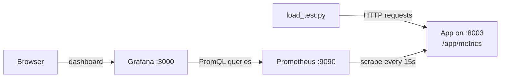

# Python and React App

This project implements an API and a basic User Interface to manage a list of users.


## Local Run

### Build

    $ pip install -r requirements.txt
	$ cd ui-people
    $ yarn install
    $ yarn build
    $ cd ..

``Python >= 3.6`` is required.

Tested with Node 12.

### Execution

    $ ./run_local.sh

## Run and build with Docker and nginx to serve static files

    $ make build
    $ make run

>**Warning**
> The yarn build is slow.

## API

### Healthcheck
```
GET http://localhost:8003/app/healthcheck
```
Response
```
{
    "status": "ok"
}
```

### Version
```
GET http://localhost:8003/app/version
```
Response
```
{
    "version": "0.0.1"
}
```

### Get all the people
```
GET http://localhost:8003/app/people
```

Query parameters:
- `sort_by` to sort the records. Valid values are `email`, `name`, `age`, `balance`
- `limit` to limit the number of records in the response.
- `name`: search people with `name` string included in the name field.

### Create a person
```
POST http://localhost:8003/app/people
```
Body:
```
{
	"address": "Dub",
	"age": 18,
	"balance": 10.0,
	"email": "m@g.com",
	"flag": false,
	"name": "John"
}
```
Response
```
{
    "created": "ok"
}
```
Example:
```
curl -X POST -H 'Content-Type: application/json' \
    -d '{"email":"m@g.com","flag":false,"name": "John","balance": 10.0,"address": "Dub","age": 18}' \
    http://127.0.0.1:8003/app/people
```
### Update the person Flag
```
PUT http://localhost:8003/app/people/{person_id}
```
Body:
```
{
	"flag": true
}
```

### Delete a person
```
DELETE http://localhost:8003/app/people/{person_id}
```

## Tests

    $ pytest tests/

## UI

The User Interface can be reached on http://localhost:8003/index.html

The UI is used to update a person's status: click a person in the list to toggle their flag.

Adding a person is not available in the UI. Create people through the API ([Create a person](#create-a-person)).

## Observability

The app exposes Prometheus metrics at `GET http://localhost:8003/app/metrics`:
- `http_requests_total` (counter): requests by `method`, `route` and `status`.
- `http_request_duration_seconds` (histogram): request latency by `method`, `route` and `status`.
- `http_requests_in_progress` (gauge): requests currently being handled.

Routes are labelled with their template (for example `/app/people/<person_id>`), not the raw path, so person IDs don't create new time series. Requests that match no route (such as 404s) are grouped under the label `unmatched`. Requests to `/app/metrics` are not counted in these metrics.



### Run the stack

Start the app on port 8003 first (`./run_local.sh` or `make run`), then:

    $ make observability

This starts Prometheus on http://localhost:9090 and Grafana on http://localhost:3000. Prometheus scrapes the app every 15 seconds at `host.docker.internal:8003`. The Prometheus service maps `host.docker.internal` to the host gateway, so this works on Docker Desktop and on Linux. Stop the stack with `make observability-down`.

With `make run`, the container's nginx on port 8003 proxies `/app` to the app, so the metrics endpoint is available there as well.

Grafana allows anonymous viewing. To sign in as an admin, use `admin` / `admin` (set in `docker-compose.observability.yml`).

Docker Desktop must have the project folder under **Settings → Resources → File sharing** so the config files can be mounted into the containers.

### Dashboard

The **App People** dashboard is in the **App People** folder in Grafana. It refreshes every 10 seconds and shows the last 15 minutes by default.

| Panel | Shows |
|---|---|
| Service up | `UP` or `DOWN` for the app's Prometheus scrape target |
| Requests in flight | Current number of requests being handled |
| Error rate (5xx share) | Share of requests answered with a 5xx status over the last 5 minutes |
| Request rate by route | Requests per second for each route, over the last 5 minutes |
| Latency p50 / p95 / p99 | Response time percentiles across all routes, over the last 5 minutes |
| Error responses by route and status | Requests per second answered with a 4xx or 5xx status, by route and status code |

The dashboard JSON is generated by `scripts/generate_dashboard.py`. To change the dashboard, edit that script and regenerate the file:

    $ python scripts/generate_dashboard.py > observability/grafana/dashboards/app-people.json

### Generate traffic

`scripts/load_test.py` sends GET requests and some deliberately bad PUT requests (answered with 400) so the dashboard has data:

    $ python scripts/load_test.py --duration 60 --workers 2 --error-ratio 0.05

Use `--error-ratio` to raise or lower the share of bad requests, and `--url` to target a different server.

## Improvements
- Add unit tests.
- Add UI to create a person.
- Add spinner instead of description when a request was sent.
